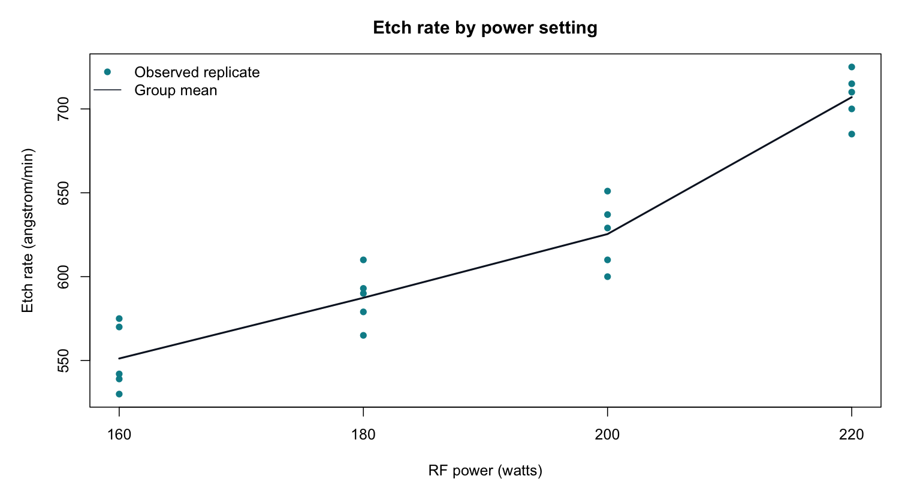

# Experimental design: RF power and plasma etch rate

James Ooko | Completed coursework with a reviewed portfolio revision, October 2026.

## Question

How does etch rate differ across RF power settings?

## Method

Treat power as a categorical factor. Fit a one-way ANOVA to 20 observations in four balanced groups. Inspect residuals and compare group means using Tukey-adjusted intervals.

## Findings

Mean etch rates rise from 551.2 at 160 W to 707.0 angstrom/min at 220 W. The latter is the highest tested mean, not a proven operating optimum.

ANOVA: F(3,16) = 66.80, p = 2.88e-9. All six Tukey pairwise comparisons have adjusted p-values below 0.05. Shapiro-Wilk p = 0.215; Fligner-Killeen p = 0.791.

## Interpretation limits

This is a textbook experiment reanalyzed for coursework, not an experiment I conducted. Independence and randomization depend on the source design. Small groups limit diagnostic power; a nonsignificant test does not prove assumptions. Results apply only to the tested settings and do not measure cost, uniformity, or wafer damage.

## Run and inspect

From the repository root, run `Rscript etch_analysis.R`. The script writes a chart and summary tables to `etch_results/`. The checked tables are also included at the repository root.

[Three-page project summary](James_Ooko_Etch_Rate_Experiment.pdf)

## Source

Montgomery, *Design and Analysis of Experiments*, plasma-etch numerical example supplied with coursework. This is a textbook reanalysis, not an experiment I conducted.

The source data and statistical methods are credited to their creators. This portfolio contribution is the analysis, checked summaries, code, and interpretation.
