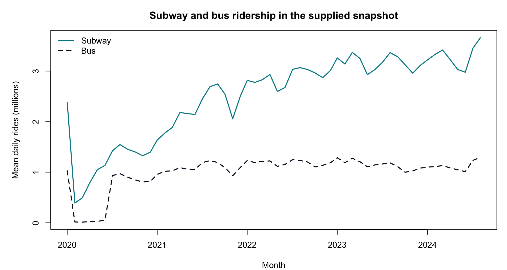

# MTA ridership exploration

James Ooko | Completed coursework with a reviewed portfolio revision, October 2026.

## Question

What patterns appear in the supplied MTA snapshot?

## Method

Check date uniqueness, missingness, and daily coverage. Summarize each service separately with mean, median, and quartiles. Aggregate all observed days within each complete month for the displayed subway and bus lines.

## Findings

The snapshot covers March 1, 2020 through October 31, 2024. Subway monthly mean daily ridership is 0.391 million in April 2020 and 3.659 million in October 2024. These are descriptive endpoints, not a causal comparison.

1,706 unique consecutive dates; no missing cells in the supplied workbook. Across the full snapshot, median subway ridership is 2,459,607 per day; median bus ridership is 1,140,776.5 per day.

## Interpretation limits

A historical course snapshot, not a live MTA feed. Counts mix weekdays, weekends, holidays, and changing reporting conditions. Recorded bus counts during 2020 need particular care because collection/reporting practices can affect interpretation. Bridge and tunnel vehicle counts are not passenger rides and are never added to transit-service totals. No forecast or causal model is claimed.

## Run and inspect

From the repository root, run `Rscript mta_analysis.R`. The script writes a chart and summary tables to `mta_results/`. The checked tables are also included at the repository root.

[Three-page project summary](James_Ooko_MTA_Ridership_Analysis.pdf)

## Source

[MTA Daily Ridership Data](https://data.ny.gov/Transportation/MTA-Daily-Ridership-Data-2020-2025/vxuj-8kew). The supplied workbook snapshot is preserved in `mta_snapshot.csv`; later portal revisions have not been reconciled record by record.

The source data and statistical methods are credited to their creators. This portfolio contribution is the analysis, checked summaries, code, and interpretation.
