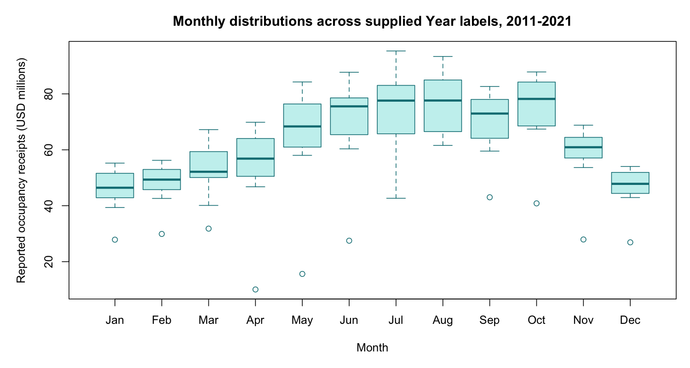

# Monthly room occupancy receipts

James Ooko | Completed coursework with a reviewed portfolio revision, October 2026.

## Question

How do reported occupancy receipts vary by month?

## Method

Check one record per Month-Year pair and 12 records per Year label. Order months explicitly. Use monthly boxplots and medians to describe the supplied snapshot without assuming a 30-observation rule for histograms.

## Findings

Across the supplied 2011-2021 Year labels, October has the highest monthly median receipts ($78.20 million), while January has the lowest ($46.44 million). These pooled summaries are descriptive, not a forecast.

132 records with no missing cells and no duplicate Month-Year pairs. Each month has 11 observations. Occupancy.Receipts is analyzed separately from Occupancy.Tax; neither field is a room occupancy percentage.

## Interpretation limits

Some Fiscal.Year labels are inconsistent with the Month and Year fields. The analysis retains the supplied Year labels and does not certify fiscal-year accounting. Raw dollar amounts are not inflation-adjusted; tax rates and economic conditions can vary. Pooling years obscures shocks and trends. This is a local coursework snapshot, not verified current state revenue reporting.

## Run and inspect

From the repository root, run `Rscript occupancy_analysis.R`. The script writes a chart and summary tables to `occupancy_results/`. The checked tables are also included at the repository root.

[Three-page project summary](James_Ooko_Occupancy_Receipts_Analysis.pdf)

## Source

[Connecticut Department of Revenue Services: Room Occupancy Tax By Month](https://data.ct.gov/d/6ydi-htg8). The supplied coursework snapshot is preserved in `occupancy_snapshot.csv`; it has not been reconciled record by record with the current portal.

The source data and statistical methods are credited to their creators. This portfolio contribution is the analysis, checked summaries, code, and interpretation.
